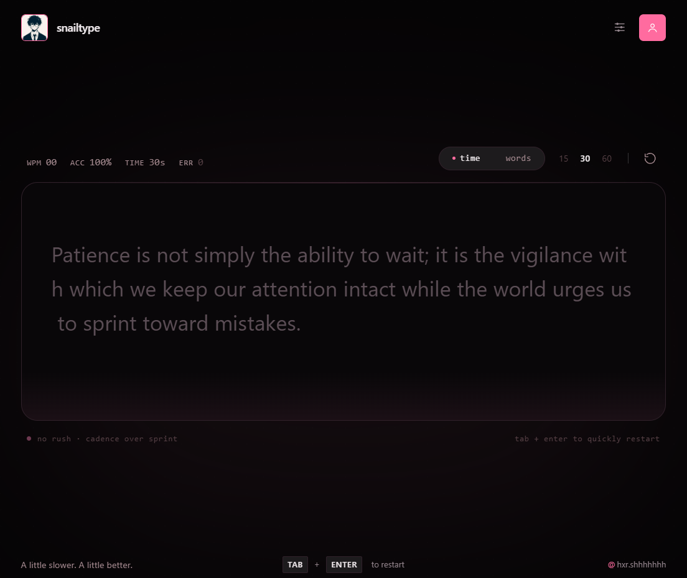

# SnailType

<p align="center">
  **A little slower. A little better.**
</p>

<p align="center">
  A minimal typing speed test designed for focus, accuracy, and consistency.
</p>

<p align="center">
  
</p>

---

## About

SnailType is a minimalist typing test experience built to help users measure their typing speed, improve accuracy, and develop a consistent typing rhythm.

Designed around a distraction-free interface, it combines real-time typing feedback with a calm, dark visual aesthetic.

## Features

- **Timed tests** — 15, 30, and 60-second sessions.
- **Word-based tests** — 10, 25, and 50-word sessions.
- **Live performance metrics** — WPM, accuracy, and typing errors.
- **Interactive typing experience** — character tracking, backspace corrections, and a responsive caret.
- **Keyboard shortcuts** — restart tests and switch passages quickly.
- **Local persistence** — save preferences and statistics in the browser.
- **Minimal design** — dark interface with subtle pink accents.

## Tech Stack

- Next.js
- React
- TypeScript
- Tailwind CSS
- Vitest

## Getting Started

### Prerequisites

- Node.js 20+
- npm

### Installation

```bash
git clone https://github.com/Devrohitanand/snailtype.git
cd snailtype
npm install
npm run dev
```

Open [http://localhost:3000](http://localhost:3000) in your browser.

## Project Status

SnailType is under active development. The repository is being updated incrementally as implementation and documentation progress.

## License

No license has been specified yet.

---

<p align="center">
  <em>Find your rhythm. One word at a time.</em>
</p>
